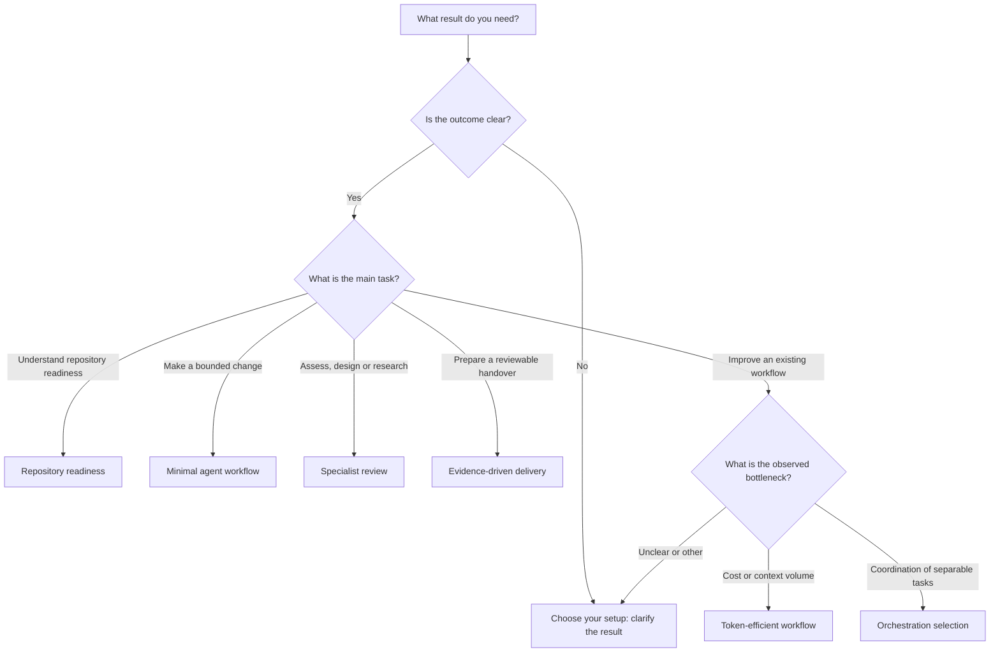

# Find a recipe for your work

Start with the result you need. This library offers **recipes** for doing the
work, a **catalog** of possible ingredients, and **evaluations** showing the
scope of the evidence. You do not need to install the entire catalog.

## Ask your agent to help choose

Give your agent access to this checkout and ask:

```text
Read AGENTS.md in this repository. I want to [goal] using [agent client]
on [project or source material]. My constraints are [constraints].
Use the decision tree to recommend one recipe, the minimum skills/tools,
optional additions and a concrete first step. State assumptions and evidence
limits. Give advice only; do not install anything or change my project.
```

If your client does not automatically discover `AGENTS.md`, explicitly point
it to the file. The [selection recipe](../recipes/choose-your-setup.md) has a
full prompt. Reading this library does not install its upstream references.

## Decision tree



Follow the matching recipe below. If several apply, start with the one that
produces your immediate output; add another only for a distinct gap.

| I want to… | Recipe | Expected output |
| --- | --- | --- |
| Know which skills and tools fit my work | [Choose your setup](../recipes/choose-your-setup.md) | Minimum setup, reasoning and first step |
| Understand whether an agent can work in a repository | [Repository readiness](../recipes/repository-readiness.md) | Evidence, unknowns and prioritized gaps |
| Implement a bounded change | [Minimal agent workflow](../recipes/minimal-agent-workflow.md) | Verified change and known limitations |
| Assess, design or research a specialist question | [Specialist review](../recipes/specialist-review.md) | Source-backed findings or a design/report |
| Hand over completed work for review | [Evidence-driven delivery](../recipes/evidence-driven-delivery.md) | Reviewable result with actual check outcomes |
| Reduce the cost of a successful task | [Token-efficient workflow](../recipes/token-efficient-workflow.md) | Comparison with a measured baseline |
| Decide whether several agents would help | [Orchestration selection](../recipes/orchestration-selection.md) | Justified coordination choice and boundaries |

## Choose your level of detail

These are reading routes, not readiness scores or mandatory stages.

| Your situation | Start with | Expand when |
| --- | --- | --- |
| Starting out | One recipe, one agent and existing tools; use the example prompt | A specific step lacks a procedure or capability |
| Doing specialist work | A focused discipline and its exact skill, requirements and evidence | Another discipline answers a separate question |
| Improving team workflows | Shared project instructions, evidence-driven delivery and representative evaluations | A measured context, cost or coordination problem justifies more tooling |

## Understand the layers

| Layer | Question it answers | Where to look |
| --- | --- | --- |
| Project instructions | What context, conventions and boundaries always apply? | The target project's `AGENTS.md`; [drafting skill](../agents-md/SKILL.md) |
| Recipe | Which steps and ingredients achieve this output? | [Recipes](../recipes/README.md) |
| Skill | Which reusable procedure helps with this step? | [Skill catalog](../catalog/README.md); three [original implementations](../skills/README.md) |
| Tool or MCP integration | Which action or information source is needed? | [Tool catalog](../catalog/README.md#tools) |
| Harness | Which client executes the agent, with what access and discovery rules? | Your client documentation and [portability](portability.md) |
| Orchestration | Is coordination across agents worth its overhead? | [Orchestration recipe](../recipes/orchestration-selection.md) |

Experience level and evidence are separate from these layers. A source-reviewed
tool is not automatically suitable for beginners, and an advanced workflow is
not automatically better tested. Read each entry's **Recommendation**,
**Evidence**, **Last reviewed**, requirements and limitations.

## Where is the readiness scan?

The [Agentic Readiness Assessment catalog entry](../catalog/skills/development/agentic-readiness-assessment.md)
links to Exadel's upstream skill. This repository contains the reference and
an [evaluation on one synthetic repository](evaluations/2026-10-30/README.md),
not a bundled scanner or a readiness result for your project.

Use the [readiness recipe](../recipes/repository-readiness.md) to choose between
a lightweight context check and a comprehensive upstream assessment. The latter
has report, command and probe effects that need to fit your authorized scope.

## Evaluated starting workflows

Choose by task, then inspect the exact upstream skill and applicable harness
instructions. Six choices now have pinned source and license reviews and
single-fixture comparisons in the [evaluation report](evaluations/2026-10-30/README.md).
These results support scoped use, not a universal validated bundle. Add a
second skill when it provides a distinct output or check.

| Task | Choice | Advice after evaluation | Remaining boundary |
| --- | --- | --- | --- |
| Implement a behavioral change | [Matt Pocock TDD](../catalog/skills/development/matt-pocock.md) | Recommend for explicit test-first work | Agree test seams; one small fixture does not prove better correctness |
| Define a larger change | [Addy's SDD](../catalog/skills/development/addy-osmani.md) | Recommend for drafting specifications; stop for review | Later phases not evaluated; OpenSpec remains an untested alternative |
| Assess repository readiness | [Exadel assessment](../catalog/skills/development/agentic-readiness-assessment.md) | Optional comprehensive audit; omit from lightweight default | Heavy report, score gates, Python validator and required commercial closing link |
| Review web accessibility | [Accessibility Audit](../catalog/skills/accessibility-ux/humbleteam-accessibility.md) | Recommend within its bounded web checklist | Not full WCAG conformance; needs runtime and assistive-technology testing |
| Diagnose SEO issues | [Marketing Skills: seo-audit](../catalog/skills/marketing-discovery/marketing-skills.md) | Exclude tested revision from default recommendation | Outdated tool guidance; re-review against current primary sources |
| Examine a security design | [Threat modeling](../catalog/skills/security-privacy/openai-threat-model.md) | Recommend for explicit AppSec modeling with context validation | Static conditional model; no security audit or exploit verification |

For other work, browse [all disciplines](../catalog/README.md), the
[full selection report](skill-selection-report.md) or
[find more skills](find-more-skills.md). Read the
[conflict guide](selection-guide.md) when combining workflows.
