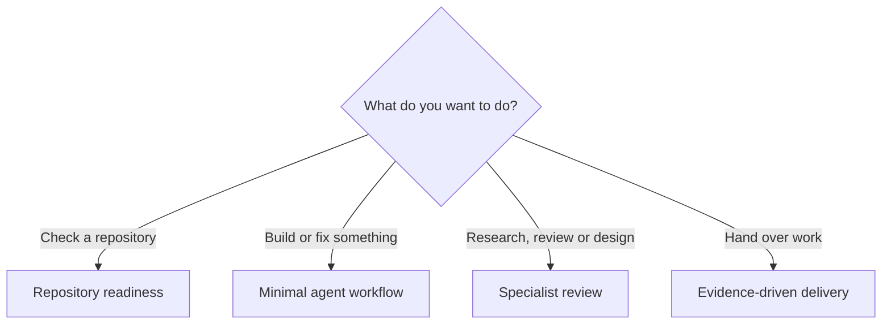

# Find a recipe

The [README](../README.md) is the short starting point. Use this tree if you
prefer a visual route; you do not need to choose an experience level first.

## Decision tree

Open the matching [recipe](../recipes/README.md). Each contains ingredients,
steps, a copyable prompt and the expected evidence.

## Ask your agent to help choose

Describe your goal and ask the agent to read [AGENTS.md](../AGENTS.md).
It should recommend a recipe, identify anything missing and give one first
step. The [selection recipe](../recipes/choose-your-setup.md) explains the
process. Point to the file explicitly if your client does not discover it.

## Improve an existing workflow

Only explore more tooling when you can name a problem:

- Cost or context volume: [token-efficient workflow](../recipes/token-efficient-workflow.md).
- Coordination of separable tasks: [orchestration selection](../recipes/orchestration-selection.md).
- Recurring session friction: [session retrospective](../recipes/session-retrospective.md).

For ingredient details, browse the [catalog](../catalog/README.md). The
[selection guide](selection-guide.md) explains the layers and conflicts;
[dated evaluations](evaluations/2026-10-30/README.md) record what was actually
tested. These details are available when needed, not prerequisites to start.
